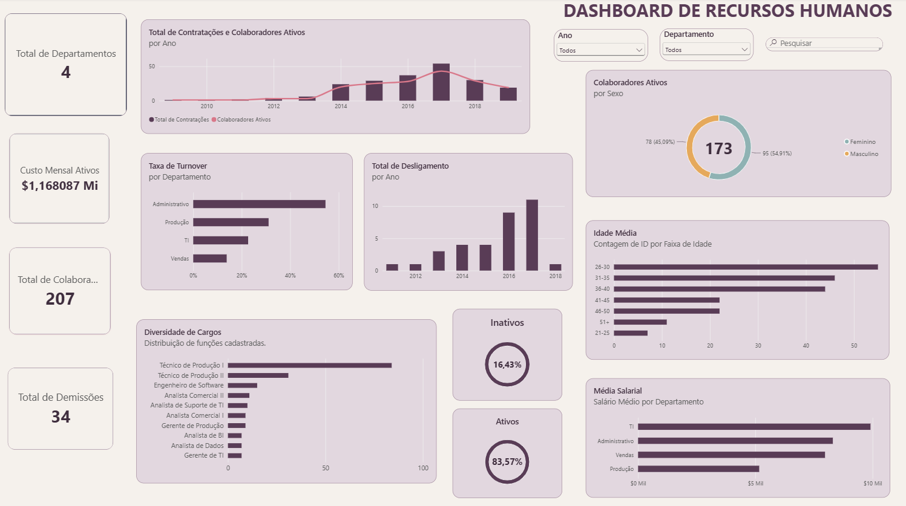

# 📊 Dashboard de Indicadores de Recursos Humanos

<p align="center">
  
</p>

<p align="center">
   Análise de Dados | Business Intelligence | Power BI
</p>

---

## 📌 Sobre o projeto

Dashboard interativo de Recursos Humanos desenvolvido no Power BI, com o objetivo de organizar informações, acompanhar indicadores e facilitar a análise de dados relacionados à gestão de pessoas.

O projeto apresenta uma visão geral dos colaboradores da organização, permitindo acompanhar admissões, desligamentos, distribuição de cargos, departamentos e indicadores de rotatividade.

## 🎯 Objetivos

- Acompanhar indicadores de Recursos Humanos.
- Analisar a distribuição de colaboradores por departamento e cargo.
- Monitorar admissões e desligamentos.
- Identificar padrões de rotatividade.
- Facilitar a interpretação dos dados por meio de visualizações interativas.

## 📈 Indicadores apresentados

- Total de colaboradores.
- Total de departamentos.
- Colaboradores ativos e inativos.
- Percentual de colaboradores ativos e inativos.
- Custo mensal com colaboradores ativos.
- Total de admissões.
- Total de desligamentos.
- Taxa de Turnover por departamento.
- Quantidade e diversidade de cargos.
- Distribuição de colaboradores por sexo.
- Faixa etária dos colaboradores.
- Média salarial por departamento.

## 🛠️ Tecnologias utilizadas

| Ferramenta | Aplicação |
|---|---|
| Power BI | Criação do dashboard |
| Power Query | Tratamento e transformação dos dados |
| DAX | Criação de medidas e indicadores |
| Kaggle | Fonte da base de dados |

## 🔎 Funcionalidades

- Filtro interativo por ano.
- Filtro por departamento.
- Pesquisa e exploração dos dados.
- Cartões com indicadores de desempenho.
- Gráficos de distribuição e comparação.
- Análise de admissões e desligamentos.
- Visualização da distribuição salarial por departamento.

## 📂 Estrutura do repositório

```text
dashboard-indicadores-rh/
│
├── Imagens/
│   └── dashboard-rh.png
│
├── Dados/
│   └── base-rh.xlsx
│
├── Dashboard
│    └── Painel de Indicadores de Recursos Humanos.pbix
│
└── README.md
```

## 📚 Fonte dos dados

Base de dados de Recursos Humanos disponibilizada no Kaggle, utilizada para fins educacionais e de desenvolvimento prático em análise de dados.

## 👩‍💻 Autora

**Mayara Borges**

Projeto desenvolvido como parte do aprendizado em Análise de Dados e Business Intelligence.
